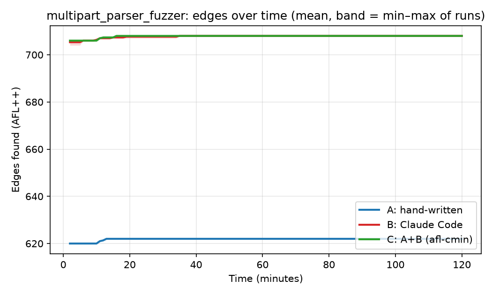
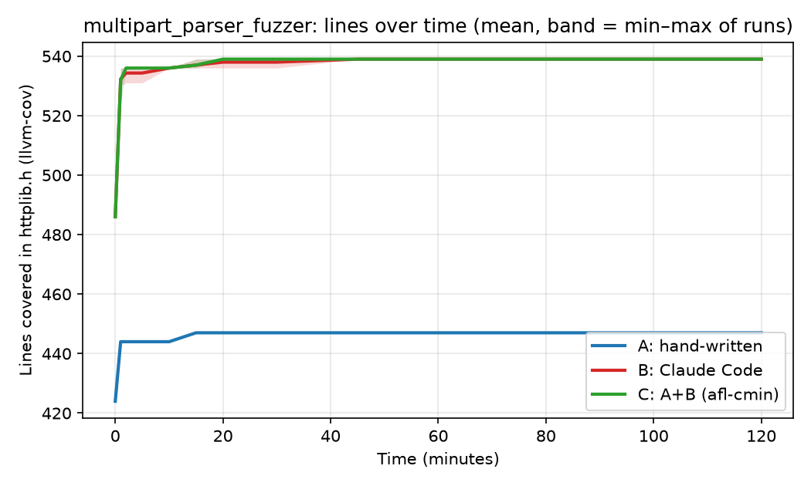
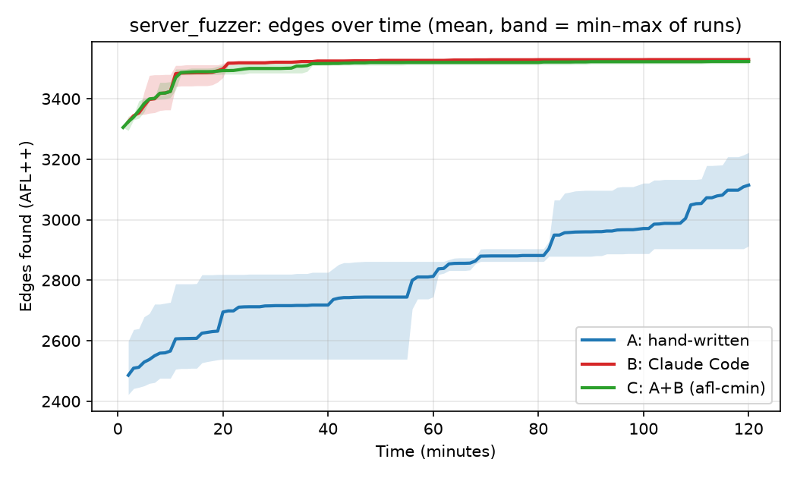
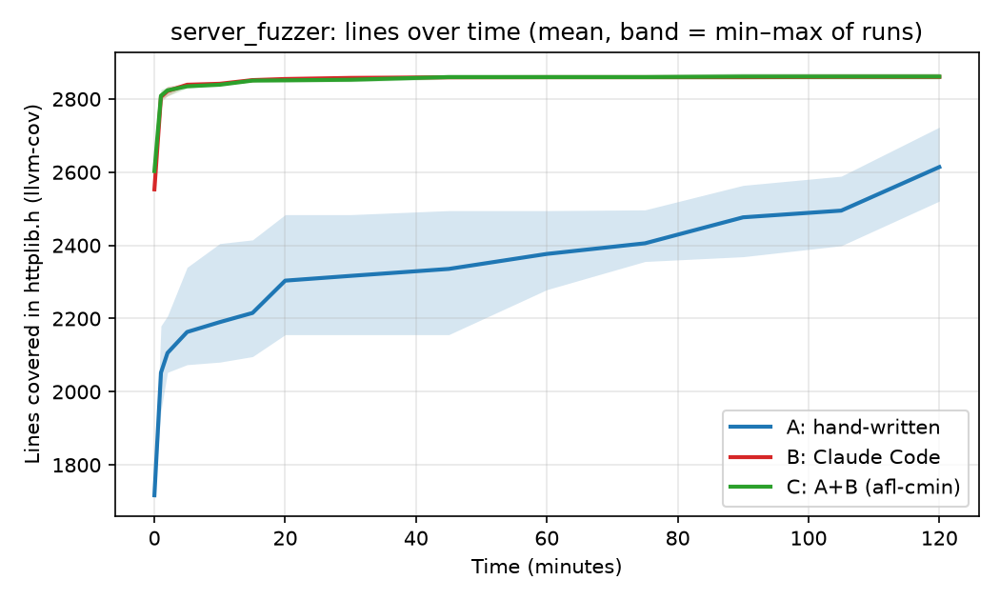

# Experiment analysis: `exp-02`

Edges = AFL++ `edges_found`; lines = llvm-cov line coverage of `httplib.h` from replaying each run's queue through `out/cov/<target>`. Values are mean (min–max) over runs.

## `multipart_parser_fuzzer`

| Arm | Runs | Final edges | Final lines (httplib.h) | Total execs (M) |
|---|---|---|---|---|
| A: hand-written | 3 | 622.0 (622–622) | 447.0 (447–447) | 14.7 (13.1–16.2) |
| B: Claude Code | 3 | 708.0 (708–708) | 539.0 (539–539) | 28.1 (22.6–34.7) |
| C: A+B (afl-cmin) | 3 | 708.0 (708–708) | 539.0 (539–539) | 21.1 (19.5–24.4) |

**Pairwise comparison of final coverage** (A12 = probability that a run of the first arm beats a run of the second; 0.5 = no difference, 1.0 = always better).

| Comparison | Metric | A12 | Exact Mann-Whitney p (two-sided) |
|---|---|---|---|
| B vs A | edges | 1.00 | 0.100 |
| B vs A | lines | 1.00 | 0.100 |
| C vs A | edges | 1.00 | 0.100 |
| C vs A | lines | 1.00 | 0.100 |
| C vs B | edges | 0.50 | 1.000 |
| C vs B | lines | 0.50 | 1.000 |

With 3 runs per arm, the smallest possible two-sided p-value is 0.100, so report A12 as the main effect size.

**Time to reach Arm A's final mean coverage** (622 edges):

- A: hand-written: 11.8 min (reached in 3/3 runs)
- B: Claude Code: 1.0 min (reached in 3/3 runs)
- C: A+B (afl-cmin): 1.0 min (reached in 3/3 runs)

Function-level differences: see [functions_diff_multipart_parser_fuzzer.md](functions_diff_multipart_parser_fuzzer.md).

- Functions in A never reached by B: 0
- Functions in B never reached by A: 4

## `server_fuzzer`

| Arm | Runs | Final edges | Final lines (httplib.h) | Total execs (M) |
|---|---|---|---|---|
| A: hand-written | 3 | 3114.3 (2913–3222) | 2614.0 (2521–2723) | 50.7 (35.3–63.6) |
| B: Claude Code | 3 | 3529.3 (3526–3534) | 2860.3 (2859–2862) | 36.9 (17.5–51.5) |
| C: A+B (afl-cmin) | 3 | 3523.0 (3516–3534) | 2861.3 (2854–2871) | 16.5 (15.4–17.8) |

**Pairwise comparison of final coverage** (A12 = probability that a run of the first arm beats a run of the second; 0.5 = no difference, 1.0 = always better).

| Comparison | Metric | A12 | Exact Mann-Whitney p (two-sided) |
|---|---|---|---|
| B vs A | edges | 1.00 | 0.100 |
| B vs A | lines | 1.00 | 0.100 |
| C vs A | edges | 1.00 | 0.100 |
| C vs A | lines | 1.00 | 0.100 |
| C vs B | edges | 0.28 | 0.500 |
| C vs B | lines | 0.39 | 0.800 |

With 3 runs per arm, the smallest possible two-sided p-value is 0.100, so report A12 as the main effect size.

**Time to reach Arm A's final mean coverage** (3114 edges):

- A: hand-written: 103.9 min (reached in 2/3 runs)
- B: Claude Code: 1.0 min (reached in 3/3 runs)
- C: A+B (afl-cmin): 1.0 min (reached in 3/3 runs)

Function-level differences: see [functions_diff_server_fuzzer.md](functions_diff_server_fuzzer.md).

- Functions in A never reached by B: 0
- Functions in B never reached by A: 12

